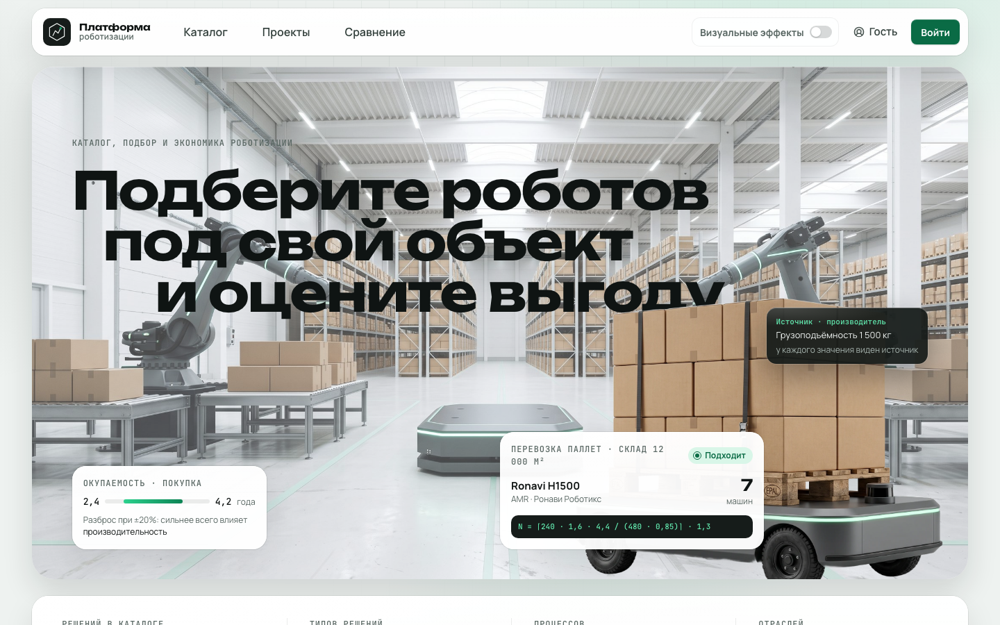

# Процессно-ориентированная платформа роботизации

**От задач предприятия к технически применимому и экономически обоснованному решению.** Платформа связывает описание объекта, его процессы, подбор оборудования, расчёт парка и инвестиционное обоснование в одном проекте. Заказчик получает ответ на вопросы: что можно роботизировать, какими решениями, в каком количестве, с какими затратами и при каких допущениях.

Идея продукта — **роботизация под ключ через единый процесс принятия решения**. Текущая реализация охватывает предынвестиционную подготовку: от исходных условий до отчёта для обсуждения с поставщиком и подготовки пилота. Обследование, поставка и внедрение остаются работой заказчика, вендора и интегратора.



## Что отличает платформу

### Процессы определяют выбор

Подбор начинается с задач и условий конкретного объекта: потоков, маршрутов, сменности, грузов и ограничений среды. Роботы сопоставляются с каждым выбранным процессом. Один продукт может решать несколько задач, а один процесс — иметь несколько альтернатив от разных производителей. Заказчик сравнивает решения в контексте своей работы, а не только паспортные характеристики.

### Самостоятельное ядро и самообслуживание

Предметная модель хранится в БД как связанные сущности: **отрасли → объекты → процессы → типы решений → продукты**, с полями площадки, характеристиками, правилами и нормативами. Серверное ядро подбора и экономики отделено от интерфейса и источников данных.

Через админку уже можно пополнять каталог, создавать объекты и процессы, настраивать поля, связи, фильтры, формулы количества, ранжирование и экономические нормативы. Правила можно проверить на параметрах объекта до сохранения. Это позволяет поддерживать и расширять платформу без программиста **в пределах существующих механизмов**. Новые инженерные модели, алгоритмы и интеграции требуют разработки; одна настройка формулы не заменяет проверку её применимости.

### Каталог развивается вместе с участниками

Вендорский кабинет позволяет передавать профиль компании, новые модели и уточнения характеристик — вручную, через JSON/CSV или поддерживаемые источники. Заявки проходят модерацию; внесение принятой заявки в каталог выполняется отдельным действием администратора. Аналитика показывает пробелы в карточках и причины, по которым модели не проходят подбор, а администратор может запросить дополнения.

Так возникает обратная связь между потребностью заказчика и качеством данных поставщика. Вовлечение интеграторов в уточнение комплектации и проектирование решения — направление развития экосистемы; отдельный кабинет и процесс работы интегратора пока не реализованы. Наличие производителя в каталоге само по себе не означает партнёрства.

### Сквозное обоснование роботизации

В одном проекте пользователь проходит последовательность:

1. **Объект и процессы:** параметры площадки, задачи, исходные трудозатраты и ограничения.
2. **Технический подбор:** применимость решений, объяснение результатов, расчёт количества и сравнение допустимых альтернатив.
3. **Экономика:** сценарии «без роботизации», «покупка», «аренда/RaaS»; CAPEX, OPEX, ROI, TCO, окупаемость, NPV и IRR. Вложения учитывают также инфраструктуру, ПО, интеграцию, пусконаладку и обучение.
4. **What-if и риски:** изменение допущений, анализ чувствительности, интервалы оценок и стресс-сценарии.
5. **План и отчёт:** имитация смены на схеме объекта, печать в PDF, выгрузка таблиц для Excel и CSV.

Экономика раскрывается **по процессам и по выбранной программе в целом**. Модель учитывает совместное использование персонала несколькими процессами, ограничивает высвобождение исходной численностью и показывает невыгодные операции. Можно менять состав программы и оценивать предложения по её корректировке с учётом бюджета. Расчёт RaaS использует допущения модели; реальные тарифы и условия договора требуют подтверждения поставщиком.

### Результат можно проверить

Платформа разделяет **техническую применимость, обоснованность количества и готовность к экономике**. Подходящий по отдельным характеристикам робот не получает автоматически достоверный ROI: нужны применимая модель количества, входные данные и стоимость. При нехватке сведений результат остаётся неполным; неизвестное количество не подменяется единицей при передаче из подбора в экономику.

Вердикты сопровождаются причинами, расчёты — формулами и подстановками, характеристики — сохранёнными источниками. Допущения и вопросы для подтверждения поставщиком передаются вместе с выбранным решением. Импорт и парсеры помогают актуализировать каталог, сохраняя ручные исправления.

Дополнительная проверка — имитация потока заданий на плане: маршруты, очереди, зарядка, пиковая нагрузка и отказы. Она позволяет увидеть расхождение расчётного парка с модельной нагрузкой. Это упрощённая имитация без физики столкновений; её результаты не пересчитывают экономику автоматически.

## Масштабирование и границы реализации

**Уже работает:** каталог, администрирование модели, кабинет вендора и модерация, подбор с объяснениями, расчёт парка, экономика, What-if, редактор плана, имитация и отчёт. Сквозные шаги интерфейса доступны для склада, аэропорта и медучреждения. Полнота результата зависит от данных и применимости моделей; демонстрационное покрытие описано ниже.

**Расширяемость архитектуры:** новые роботы, процессы и объекты добавляются через сущности и связи, характеристики и правила переиспользуются, а импорт выполняет отдельный воркер. Это основа для расширения предметного охвата; производительность при больших каталогах и числе пользователей нагрузочными испытаниями не подтверждена.

**Развитие продукта:** полноценное участие интеграторов, подключения к WMS/ERP и сохранение версий расчётов и каталога. Сейчас расчёты выполняются на актуальных данных; результат служит предварительным обоснованием и требует проверки на объекте перед инвестиционным решением.

## Быстрый старт

Нужны Docker с Compose v2 и свободные порты 80 и 5432.

```bash
git clone <адрес репозитория> robots-platform
cd robots-platform
make up            # или: docker compose up -d --build
```

После запуска сайт: <http://localhost>. Вход: `admin` / `demo-2026` (также `user`, `guest`; кабинет вендора — `ronavi` с тем же паролем). Открыть демо «Склад Внуково-Юг» и пройти шаги «Подбор → Сравнение → Экономика → What-if → План → Отчёт».

В текущем локальном Compose включён DEV-контур с синтетическими допущениями для выбранных демопроектов — см. раздел «Демо-данные». Для другого HTTP-порта: `make up HTTP_PORT=8080`.

Остановить: `make down`. Сбросить данные: `make reset`.

Развёртывание на сервере с Coolify: файл [docker-compose.coolify.yaml](docker-compose.coolify.yaml). Общие настройки — в [руководстве по развёртыванию](docs/03-deployment.md).

> Если интерфейс тормозит, выключите **«Визуальные эффекты»** в верхней панели. Выбор сохраняется в браузере; данные и расчёты остаются прежними.

## Сервисы

| Сервис | Назначение | Адрес |
|---|---|---|
| `traefik` | Единая точка входа | :80 |
| `web` | Nuxt 4 (Vue 3), страницы и имитация в браузере | `/` |
| `platform-api` | FastAPI: подбор, экономика, проекты | `/platform/api/v1` |
| `platform-worker` | Импорт каталога и парсеры | — |
| `db` | PostgreSQL 16 | :5432 |

Swagger UI: <http://localhost/platform/api/v1/docs>.

## Переменные окружения

Основные настройки локального запуска из `docker-compose.yaml` и настроек API:

| Переменная | По умолчанию | Назначение |
|---|---|---|
| `DATABASE_URL` | `postgresql+psycopg://robots:robots@db:5432/platform` | БД платформы |
| `POSTGRES_ADMIN_URL` | `…/postgres` | Создание базы при старте |
| `SESSION_SECRET` | `platform-demo-session-secret` | Подпись cookie. Сменить в проде |
| `UPLOAD_DIR` | `/app/uploads` | Фото карточек и подложки схем |
| `ROOT_PATH` | `/platform` | Префикс API за Traefik |
| `NUXT_PUBLIC_PLATFORM_API_BASE` | `/platform/api/v1` | Путь к API для сайта |
| `DEMO_SYNTHETIC_ENABLED` | `true` в текущем локальном Compose и настройках API | DEV-допущения для выбранных демопроектов; для отключения явно задать `false` в окружении API |

Полный список: [docs/03-deployment.md](docs/03-deployment.md).

## Структура репозитория

```
frontend/   Nuxt 4: страницы, компоненты, имитация (app/sim)
platform/   FastAPI: app/api, app/domain (подбор, экономика), app/parsers, alembic, seed
docs/       Документация, скриншоты, генераторы приложений
docker-compose.yaml, Makefile
```

## Демо-данные

Снимок каталога из **555 карточек** и три демопроекта (склад, аэропорт, медучреждение) загружаются при первом запуске из `platform/seed/platform.sql`; затем применяются миграции. Количество карточек характеризует объём каталога, а не число полностью подтверждённых и готовых к внедрению решений.

**Исходный каталог и DEV-синтетика разделены.** Дополнения из `platform/seed/demo_synthetic.json` применяются отдельным слоем к выбранным демопроектам, не записываются в исходные карточки и не подставляются в обычные проекты. Они помечены `demo_synthetic`, содержат происхождение и пояснения и не являются подтверждёнными характеристиками производителей. Отключение требует явного `DEMO_SYNTHETIC_ENABLED=false` в окружении API: обычный `make up` сейчас запускает синтетический контур.

В [аудите от 20 октября 2026 года](docs/22-demo-engineering-models.md) проверены **30 процессов трёх объектов** и передача в экономику всех **62 условно подходящих альтернатив**. Альтернатива здесь — сочетание объекта, процесса и карточки. Все положительные допуски условны; у двух процессов технически подходящего решения нет. Это демонстрация работы моделей с явно заданными допущениями, а не подтверждение эффективности реальных внедрений. Полнота экономики относится к выбранной программе роботизации, а не ко всем затратам предприятия.

Правила работы с неполными характеристиками: [контракт подбора](docs/19-incomplete-selection.md). Инженерные модели, допущения и результаты проверок: [актуальный аудит](docs/22-demo-engineering-models.md).

## Тесты

```bash
(cd platform && uv run pytest -q)          # нужна БД из compose
(cd frontend && npm ci && npm run test:sim && npm run test:selection && npm run typecheck)
```

## Документация

| Документ | Файл |
|---|---|
| Оглавление пакета | [docs/README.md](docs/README.md) |
| Развёртывание | [docs/03-deployment.md](docs/03-deployment.md) |
| Архитектура | [docs/02-architecture.md](docs/02-architecture.md) |
| API | [docs/api.md](docs/api.md) |
| Экономическая модель | [docs/05-economics.md](docs/05-economics.md) |
| Администрирование | [docs/09-admin-guide.md](docs/09-admin-guide.md) |
| Подбор при неполных данных | [docs/19-incomplete-selection.md](docs/19-incomplete-selection.md) |
| Актуальный аудит DEV и инженерные модели | [docs/22-demo-engineering-models.md](docs/22-demo-engineering-models.md) |
| Ограничения и план | [docs/12-limitations-roadmap.md](docs/12-limitations-roadmap.md) |

Часть ранних документов описывает предыдущие этапы прототипа. Для текущего демонстрационного покрытия используйте аудит инженерных моделей, связанный выше.
